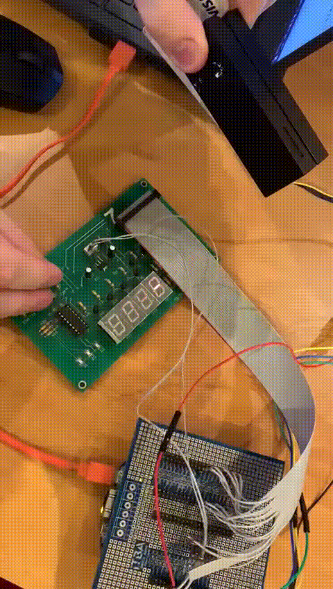
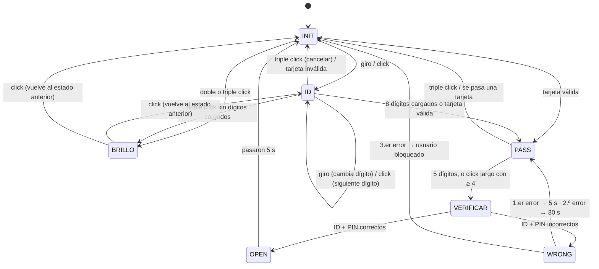

# Control de Acceso — TP4 (uC/OS-III sobre FRDM-K64F)

Sistema embebido de **control de acceso** (tipo cerradura electrónica) que corre sobre el microcontrolador **NXP Kinetis MK64FN1M0VLL12** (placa FRDM-K64F) con el sistema operativo de tiempo real **Micrium uC/OS-III**.

El usuario se identifica con un **ID de 8 dígitos**, que puede ingresar a mano con un encoder rotativo o leer **pasando una tarjeta de banda magnética**. Después ingresa un **PIN de 4 o 5 dígitos**. Si los datos coinciden con algún usuario de la base, la puerta se "abre" durante 5 segundos. Si no, se aplican penalizaciones de tiempo y, al tercer intento fallido, el usuario queda bloqueado.

La interfaz con el usuario es una placa con:
- un **display de 7 segmentos de 4 dígitos** (multiplexado),
- un **encoder rotativo con pulsador**,
- **3 LEDs de estado** (multiplexados),
- un **lector de tarjetas magnéticas** (track 2, ISO/IEC 7811).

<p align="center">
  
</p>

Es el Trabajo Práctico N.º 4 de una materia de microprocesadores. La versión anterior del proyecto (TP1) funcionaba en *bare-metal* con un loop de polling; en este TP la aplicación se migró a un RTOS: tiene tareas, semáforos y una cola de mensajes.

---

## Tabla de contenidos

1. [Arquitectura general](#arquitectura-general)
2. [Tareas del RTOS](#tareas-del-rtos)
3. [Máquina de estados de la aplicación](#máquina-de-estados-de-la-aplicación)
4. [Cómo se usa](#cómo-se-usa)
5. [Drivers](#drivers)
6. [Base de usuarios](#base-de-usuarios)
7. [Conexionado (pinout)](#conexionado-pinout)
8. [Estructura del repositorio](#estructura-del-repositorio)
9. [Compilación y carga](#compilación-y-carga)
10. [Estado del proyecto y observaciones](#estado-del-proyecto-y-observaciones)
11. [Autores](#autores)

---

## Arquitectura general

El software está organizado en capas:

```
┌──────────────────────────────────────────────────────────────┐
│  main.c   → crea las tareas de uC/OS-III y arranca el kernel │
│  App.c    → máquina de estados del control de acceso         │
├──────────────────────────────────────────────────────────────┤
│  Drivers de alto nivel (source/drivers)                      │
│   display · encoder · button · leds · card_reader · user ·   │
│   message                                                    │
├──────────────────────────────────────────────────────────────┤
│  Servicios de bajo nivel                                     │
│   timer (timers por software) · SysTick · gpio (+ IRQ PORTx) │
├──────────────────────────────────────────────────────────────┤
│  SDK: CMSIS MK64F12 + startup  ·  RTOS: uC/OS-III, uC-CPU,   │
│  uC-LIB (puerto ARM Cortex-M4, GNU)                          │
└──────────────────────────────────────────────────────────────┘
```

**Modelo de eventos.** Cada driver de entrada (encoder, botón, lector de tarjetas y "mensajes" internos) tiene su propio **semáforo de uC/OS-III**. Cuando detecta un evento, hace `OSSemPost` sobre ese semáforo. La tarea principal se bloquea con **`OSPendMulti`** sobre los 4 semáforos a la vez y solo se despierta cuando hay algo para procesar, así que no consume CPU mientras espera.

```
 encoder  ──OSSemPost──┐
 botón    ──OSSemPost──┤
 tarjeta  ──OSSemPost──┼──► OSPendMulti (TaskMain) ──► App_Run() ──► FSM
 mensaje  ──OSSemPost──┘
```

El "mensaje" (`message.c`) es un evento sintético que genera la propia aplicación con `messageSetStatus(ACTIVADO)`. Sirve para refrescar el display al entrar en un estado nuevo y para avanzar los estados temporizados (puerta abierta, PIN incorrecto). El timer de 1 segundo de la app también genera este evento en cada tick.

## Tareas del RTOS

Se crean en [source/main.c](source/main.c). Todas tienen prioridad 2 y está habilitado el *round-robin* (`OS_CFG_SCHED_ROUND_ROBIN_EN = 1`). El tick del sistema está configurado a 1 kHz.

| Tarea | Stack | Función |
|---|---|---|
| `App Task Main` | 512 | Inicializa la CPU, crea la cola `msgqTest` (16 mensajes), llama a `App_Init()` y después ejecuta `App_Run()` en un loop infinito. |
| `Task Refresh` | 256 | Se bloquea en `OSQPend` sobre `msgqTest`. Recibe el índice del usuario que accedió (lo publica la app con `OSQPost`). El procesamiento está pendiente: `//ActualizarPiso(p_msg)`. |
| `Task Cloud` | 256 | Esqueleto: se despierta cada 15 s; el envío a la nube (`//sendCloud()`) todavía no está implementado. |
| `Task Live` | 256 | Esqueleto: se despierta cada 15 s; el *keep-alive* (`//KeepAlive()`) todavía no está implementado. |

## Máquina de estados de la aplicación

La lógica está en [source/App.c](source/App.c). Los eventos que recibe la FSM son:

| Evento | Origen |
|---|---|
| `EVENTO_DER` / `EVENTO_IZQ` | Giro del encoder a la derecha / izquierda |
| `EVENTO_CLICK` | Un click |
| `EVENTO_CLICK_2` | Doble click |
| `EVENTO_CLICK_3` | Triple click (o más) |
| `EVENTO_CLICK_LONG` | Click sostenido (≥ 600 ms) |
| `EVENTO_TARJETA` | Se terminó de leer una tarjeta |
| `EVENTO_MSG` | Evento interno de refresco / paso del tiempo |



### Detalle de cada estado

| Estado | Display | Comportamiento |
|---|---|---|
| `INIT` | `IdLE` (scroll) | Reposo. Cualquier giro o click pasa a cargar el ID; doble o triple click entra al menú de brillo. Si se pasa una tarjeta válida, el ID se toma de ella y salta directo al PIN. |
| `ID` | `USEr`, después los dígitos | El dígito actual parpadea. Girando se cambia el valor (0–9, con vuelta circular), y con click se avanza al dígito siguiente. Doble click borra el último dígito (si todavía no se cargó ninguno, entra al menú de brillo). Triple click cancela todo. |
| `PASS` | `PASS`, después `- - - x` | Solo se ve el dígito que se está editando; los anteriores aparecen como guiones. Al completar 5 dígitos se verifica. Para un PIN de 4 dígitos se confirma con un **click largo**. Doble click borra y triple click cancela. |
| `BRILLO` | `brIghtnESS`, después `b1` / `b 2` / `b  3` | Girando se cambia entre 3 niveles de brillo, que también se reflejan en los LEDs. Con click se vuelve al estado anterior. |
| `VERIFICAR` | — | Compara el ID y el PIN contra la base con `checkUser()`. |
| `OPEN` | `OPEn` | Acceso concedido: LED3 encendido y LED1 parpadeando durante **5 s**. El índice del usuario queda guardado para enviarlo a `Task Refresh` por la cola. |
| `WRONG` | `CLOSEd` | Acceso denegado: LED2 encendido y LED1 parpadeando. Después del 1.er error hay que esperar **5 s**, y después del 2.º, **30 s**; en ambos casos se vuelve a pedir el PIN. Al **3.er error** se llama a `blockUser()` y se vuelve a `INIT`. |

## Cómo se usa

1. **Despertar el equipo:** girar el encoder o hacer click. El display muestra `USEr`.
2. **Ingresar el ID (8 dígitos):**
   - girar para elegir el número,
   - hacer click para confirmarlo y pasar al siguiente,
   - *o, en lugar de cargarlo a mano, pasar la tarjeta magnética.*
3. **Ingresar el PIN:** igual que el ID. Con 5 dígitos se verifica automáticamente; con 4 dígitos hay que confirmar con **click largo**.
4. Atajos disponibles en cualquier momento de la carga:
   - **doble click** → borra el último dígito,
   - **triple click** → cancela y vuelve al inicio.
5. **Ajustar el brillo:** desde el reposo (o desde el ID sin dígitos cargados), hacer doble click, girar para elegir el nivel y hacer click para salir.

## Drivers

Todos los drivers están en [source/drivers/](source/drivers/).

| Driver | Archivo | Descripción |
|---|---|---|
| **GPIO** | [gpio.c](source/drivers/gpio.c) | Configura los pines (MUX, pull-ups y dirección), lee y escribe valores, y registra callbacks de interrupción por pin (`gpioIRQ`). Los handlers `PORTx_IRQHandler` se encargan de despachar cada interrupción a su callback. |
| **SysTick** | [SysTick.c](source/drivers/SysTick.c) | Configura el SysTick a 1 kHz (núcleo a 100 MHz) y llama a un callback en cada interrupción. |
| **Timer** | [timer.c](source/drivers/timer.c) | Timers por software sobre el SysTick (resolución de 1 ms), en modo `PERIODIC` o `SINGLESHOT`, con callback. Ofrece `start`, `stop`, `reset`, `restart`, `activate`, `changePeriod`, etc. |
| **Encoder** | [encoder.c](source/drivers/encoder.c) | Lee las señales A y B del encoder cada 1 ms y las procesa con una FSM de 7 estados (`START`, `LEFT_1..3`, `RIGHT_1..3`). Solo genera `LEFT` o `RIGHT` cuando se completa la secuencia de cuadratura entera, lo que funciona como antirrebote. |
| **Botón** | [button.c](source/drivers/button.c) | Muestrea el pulsador cada 4 ms. Distingue click simple, doble, triple y click largo (≥ 600 ms) usando una ventana de agrupamiento de clicks. |
| **Display** | [display.c](source/drivers/display.c) | Maneja 4 dígitos de 7 segmentos multiplexados: refresca un dígito por ms y elige cuál con dos líneas de selección (`SEL0` y `SEL1`). Usa un buffer de hasta 16 caracteres, con un mapa de dígitos y letras (`IDX_*`). Tiene 4 modos: `CLEAR`, `SCROLL` (desplaza cada 600 ms), `BLINK` (parpadea cada 175 ms los dígitos elegidos) y `STATIC`. El brillo tiene 3 niveles, que se logran salteando ciclos de refresco (ciclo útil de 1/4, 1/2 o 1). |
| **LEDs** | [leds.c](source/drivers/leds.c) | Maneja 3 LEDs multiplexados con 2 líneas de selección (`01`, `10`, `11`; `00` significa ninguno). Refresca uno cada 4 ms. Ofrece `set`, `clear`, `toggle` y `clear_leds`. |
| **Lector de tarjetas** | [card_reader.c](source/drivers/card_reader.c) | Lee el track 2 de una banda magnética. Funciona por interrupciones: el flanco del pin `ENABLE` indica que se está pasando una tarjeta y el flanco descendente de `CLOCK` dispara la lectura de un bit de `DATA`. Guarda 200 bits a partir del primer bit en 1 y después (`processData`) arma los caracteres de 5 bits (4 de dato y 1 de paridad impar). Valida el SS `;`, el PAN, el FS `=`, los datos adicionales, el ES `?` y el LRC. El **ID son los últimos 8 dígitos del PAN** (el número de la tarjeta). Los errores posibles son `PARITY_ERROR`, `SS_EXPECTED`, `FS_EXPECTED`, `ES_EXPECTED`, `UNEXPECTED_CHARACTER` y `BAD_LRC`. |
| **Usuarios** | [user.c](source/drivers/user.c) | Base de usuarios fija en RAM. Incluye `checkUser()`, `getIDUser()` y `blockUser()` (este último invalida el PIN). |
| **Message** | [message.c](source/drivers/message.c) | Evento interno con semáforo propio, usado por la app para auto-notificarse. |

Varios drivers tienen un modo de desarrollo (`*_DEV_MODE`). Con ese modo activo, el driver pone en alto un pin de prueba mientras se ejecuta su ISR o callback, y así se puede medir el tiempo de ejecución con un osciloscopio.

## Base de usuarios

Los usuarios están definidos de forma estática en [source/drivers/user.c](source/drivers/user.c), dentro del arreglo `all_users[]`. Cada entrada tiene esta forma:

```c
typedef struct Users {
    uint8_t id[8];    // ID de 8 dígitos
    uint8_t pass[5];  // PIN
    uint8_t len;      // largo del PIN: 4 o 5
} User_t;
```

Algunos usuarios de prueba que sirven para cargar a mano con el encoder:

| ID | PIN |
|---|---|
| `00000000` | `0000` |
| `00000001` | `00001` |
| `12340000` | `1144` |
| `12345678` | `1234` |

El resto de las entradas (`11111111`, `22222222`, … `66666666`) son tarjetas genéricas de ejemplo. Para usar una tarjeta magnética real, hay que cargar como ID los últimos 8 dígitos de su PAN.

> Para agregar un usuario hay que sumar una entrada a `all_users[]` y actualizar `user_num`. La base vive en RAM y no se persiste: si un usuario queda bloqueado, vuelve a estar habilitado después de un reset.

## Conexionado (pinout)

Placa de expansión (encoder + display + LEDs), definida en [board_encoder_display.h](source/drivers/board_encoder_display.h):

| Señal | DIO | Pin K64F |
|---|---|---|
| Segmento A | DIO_1 | PTC3 |
| Segmento B | DIO_3 | PTA2 |
| Segmento C | DIO_5 | PTB18 |
| Segmento D | DIO_7 | PTC17 |
| Segmento E | DIO_9 | PTC7 |
| Segmento F | DIO_11 | PTC0 |
| Segmento G | DIO_13 | PTC8 |
| Punto decimal | DIO_15 | PTB19 |
| Selección de dígito SEL0 | DIO_2 | PTC2 |
| Selección de dígito SEL1 | DIO_4 | PTB23 |
| Encoder A | DIO_8 | PTC16 |
| Encoder B | DIO_6 | PTB9 |
| Pulsador del encoder | DIO_10 | PTC5 |
| Selección de LED 1 | DIO_14 | PTC1 |
| Selección de LED 2 | DIO_12 | PTC9 |

Lector de tarjetas magnéticas:

| Señal | Pin K64F | Notas |
|---|---|---|
| DATA | PTB11 | Activo bajo; sale primero el bit menos significativo |
| CLOCK | PTC11 | IRQ por flanco descendente |
| ENABLE | PTC10 | En bajo mientras se pasa la tarjeta; IRQ por ambos flancos |

Pines de prueba para el modo de desarrollo: PTB20 (SysTick), PTC4 (display), PTD0 (encoder), PTD2 (botón) y PTB10 (lector de tarjetas).

## Estructura del repositorio

```
.
├── docs/
│   └── demo.gif            # Demo del equipo funcionando
├── SDK/
│   ├── CMSIS/              # Headers del MK64F12, core_cm4, system_MK64F12.c
│   └── startup/            # Tabla de vectores, hardware.c/.h (hw_Init, clock a 100 MHz)
├── source/
│   ├── main.c              # Creación de tareas uC/OS-III y arranque del kernel
│   ├── App.c               # FSM del control de acceso
│   ├── drivers/            # Drivers propios (ver tabla de drivers)
│   ├── rtos/uCOSIII/       # Kernel uC/OS-III + uC-CPU + uC-LIB (puertos GNU/IAR/RealView)
│   └── ucosiii_config/     # os_cfg.h, os_cfg_app.h, cpu_cfg.h
├── .cproject / .project    # Proyecto Eclipse / MCUXpresso
└── *.launch                # Configuraciones de debug (Debug / Release)
```

## Compilación y carga

**Requisitos**
- [MCUXpresso IDE](https://www.nxp.com/mcuxpresso/ide) (basado en Eclipse CDT) con el toolchain `arm-none-eabi-gcc`.
- Placa **FRDM-K64F** (MK64FN1M0VLL12), con depurador OpenSDA (CMSIS-DAP o J-Link) o un probe externo.

**Pasos**
1. En MCUXpresso, ir a *File → Import → Existing Projects into Workspace* y elegir la carpeta del repositorio. El proyecto se importa con el nombre **`MP3-Player`**, que quedó heredado de la plantilla.
2. Elegir la configuración **Debug** o **Release**. Los símbolos que ya vienen definidos son `CPU_MK64FN1M0VLL12` y `__USE_CMSIS`.
3. Hacer *Build* y después *Debug*, usando `MP3-Player PE Debug.launch` o `MP3-Player PE Release.launch`.

La carpeta `/Debug/` de salida está ignorada en git.

## Estado del proyecto y observaciones

Lo que ya funciona:
- Ingreso de ID y PIN con el encoder, lectura de tarjetas magnéticas, verificación, penalizaciones por errores y bloqueo de usuarios.
- Control de brillo del display.
- Migración a uC/OS-III con semáforos y `OSPendMulti`.

Lo que está pendiente o incompleto:
- **`Task Cloud`, `Task Live` y `Task Refresh` son esqueletos.** Las llamadas `sendCloud()`, `KeepAlive()` y `ActualizarPiso()` están comentadas, así que todavía no hay comunicación con un servidor ni con la nube.
- **El índice del usuario se envía con retraso:** `OSQPost` no se ejecuta al abrir la puerta, sino en el siguiente evento que procesa el estado `ID`.
- **El tick de uC/OS-III no está conectado al vector SysTick.** La tabla de vectores ([startup_mk64f12.c](SDK/startup/startup_mk64f12.c#L329)) apunta a `SysTick_Handler1`, que es el handler del driver de timers, y no al `SysTick_Handler` del puerto de uC/OS-III. Además, `SysTick_Init()` reconfigura el SysTick después de `OS_CPU_SysTickInit()`. Por eso los timers por software funcionan, pero los servicios temporizados del kernel (`OSTimeDlyHMSM`, el round-robin) no reciben ticks. Hoy esto solo afecta a las tareas esqueleto. Para corregirlo hay que llamar a `OSTimeTick()` (o al handler del puerto) desde el ISR del SysTick, o bien manejar los timers desde `OSTimeTickHook()`.
- La base de usuarios está escrita directamente en el código y no se persiste en memoria no volátil.

## Autores

Según los encabezados de los archivos fuente:
- Ignacio Cutignola
- Olivia De Vincenti
- Guillermo OM
- Pedro DL
- "Micho"
- Plantilla base, `hardware.h` y `SysTick.h`: Nicolás Magliola (cátedra)

uC/OS-III, uC-CPU y uC-LIB son © Micrium / Silicon Labs, con su propia licencia.
